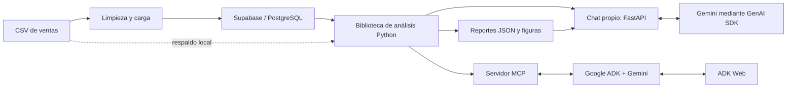

<div align="center">

# 🤖 Analista de ventas — datos, herramientas y conversación

**Pipeline analítico de ventas online con Python, Supabase, Google ADK y MCP**


[Descripción](#descripción) · [Arquitectura](#arquitectura) · [Instalación](#instalación) · [Uso](#uso) · [Informe](docs/informe/SOG2-2S26_grupo1.pdf)

</div>

---


## Descripción

Proyecto de **Sistemas Organizacionales y Gerenciales 2, grupo 1** que reúne preparación de datos, análisis estadístico y una interfaz conversacional para explorar ventas online de 2021. El usuario puede consultar tendencias, segmentos de clientes, correlaciones y gráficos mediante un agente conectado a herramientas MCP.

El procesamiento numérico reside en Python y en las herramientas del servidor; el agente organiza la interacción con esos resultados. La separación entre **cálculo analítico** y **respuesta conversacional** permite identificar de dónde procede cada salida.

## Capacidades

| Área | Función |
| --- | --- |
| Preparación | Lectura de CSV, limpieza, tipado y carga relacional. |
| Exploración | Estadísticos descriptivos y distribución por categorías. |
| Tendencias | Evolución mensual y análisis por canal o método de pago. |
| Segmentación | Agrupación por edad, género, boletín y uso de vales. |
| Correlación | Relaciones entre variables numéricas y categóricas. |
| Visualización | Generación de figuras y acceso desde el chat. |

## Arquitectura



La [capa analítica](lib/analysis.py) intenta leer PostgreSQL y utiliza el CSV como respaldo si la conexión falla. Ese modo debe distinguirse de una carga cloud correcta. El [servidor MCP](mcp_server/server.py) expone funciones analíticas y referencias a figuras; la [configuración del agente](agent/agent.py) conecta ese servidor mediante stdio.

Hay dos recorridos conversacionales: **ADK Web** usa el agente y MCP; el **chat propio de FastAPI** llama directamente a la biblioteca analítica y al SDK GenAI, compartiendo el catálogo de gráficos. El chat propio no inicia una sesión MCP remota para cada consulta.

## Datos y pipeline

El archivo `venta_online_c.csv` se conserva en [data/raw/](data/raw/venta_online_c.csv), con una copia en `docs/`. Las variables incluyen cliente, edad, género, fecha e importe de compra, número de compras, método de pago, navegador, boletín y vale.

| Etapa | Entrada de ejecución | Salida principal |
| --- | --- | --- |
| Preparación | `01_preparacion/etl.py` | Reporte de limpieza/carga y tablas de clientes/compras. |
| Exploración | `02_exploratorio/explorar.py` | Resumen descriptivo del conjunto. |
| Tendencias | `03_tendencias/tendencias.py` | Patrones temporales y comerciales. |
| Segmentación | `04_segmentacion/segmentar.py` | Comparación de grupos de clientes. |
| Correlación | `05_correlacion/correlacion.py` | Relaciones entre variables. |
| Visualización | `06_visualizacion/visualizar.py` | Figuras para revisión y consulta. |

Los reportes se escriben en `outputs/` y las figuras en `outputs/figures/`. El [esquema DBML](db/schema.dbml), su [diagrama](db/schema.png) y la [migración SQL](supabase/migrations/20260813035003_init_schema_ventas.sql) describen la estructura relacional y los catálogos.

## Instalación

### Requisitos

- Python 3.10 o posterior, conforme al requisito declarado por el proyecto, en un entorno compatible con `requirements.txt`.
- Un proyecto Supabase de práctica para reproducir la carga cloud.
- Una clave de Google AI Studio y un modelo habilitado para utilizar el chat con Gemini.

### Preparar un clon limpio

```bash
git clone https://github.com/DavidVelasquez77/AgentePractica1_G1.git
cd AgentePractica1_G1
python -m venv .venv
```

**PowerShell**, sin necesidad de activar scripts del entorno:

```powershell
.\.venv\Scripts\python.exe -m pip install -r requirements.txt
Copy-Item .env.example .env
```

**Linux/macOS**:

```bash
source .venv/bin/activate
python -m pip install -r requirements.txt
cp .env.example .env
```

En PowerShell, utilizar `.\.venv\Scripts\python.exe` en lugar de `python` en los comandos posteriores si el entorno no está activado.

### Configuración

| Variable | Uso |
| --- | --- |
| `DATABASE_URL` | Conexión SQLAlchemy/PostgreSQL para carga y lectura cloud. |
| `GOOGLE_API_KEY` | Acceso del agente al proveedor del modelo. |
| `GEMINI_MODEL` | Identificador del modelo habilitado en la cuenta. |
| `SUPABASE_URL`, `SUPABASE_ANON_KEY`, `SUPABASE_SERVICE_ROLE_KEY` | Variables incluidas en la plantilla para el entorno Supabase; la conexión analítica directa usa `DATABASE_URL`. |
| `PORT` | Puerto del chat web; por defecto `8080`. |

Completar `.env` localmente y revisar la migración antes de aplicarla en una base de práctica vacía. El identificador de modelo de la plantilla debe comprobarse en la cuenta del proveedor; puede ajustarse sin cambiar el código. Las claves de servicio y conexión pertenecen al entorno de servidor y no deben incluirse en capturas o commits.

## Uso

### Generar los análisis

> **La carga ETL reemplaza los datos de las tablas `compras` y `clientes` mediante `TRUNCATE`.** Usar una base de práctica destinada a este conjunto de datos. `run_all.py` incluye esa etapa.

Desde la raíz del repositorio:

```bash
python run_all.py
```

El comando ejecuta las seis etapas en orden. Para trabajar una etapa concreta se puede ejecutar su script individual. Revisar los mensajes y el campo `aviso_conexion` del reporte de preparación: el fallback local permite continuar el análisis y **no confirma que Supabase haya recibido los registros**.

### Abrir el chat

```bash
python web_chat.py
```

Abrir `http://localhost:8080`. La interfaz permite consultar análisis y mostrar las figuras generadas; si no puede usar el proveedor del modelo, contempla respuestas analíticas estructuradas de respaldo. Como alternativa para el recorrido del agente ADK:

En **PowerShell**, usando el entorno sin activar:

```powershell
.\.venv\Scripts\adk.exe web --port 8000
```

En **Linux/macOS**, con el entorno activado según los pasos anteriores:

```bash
adk web --port 8000
```

Abrir `http://localhost:8000` y seleccionar el agente del proyecto. La configuración del agente inicia el servidor MCP; no se requiere levantar otro servidor HTTP de herramientas por separado.

### Preguntas de ejemplo

- ¿Cómo se distribuyen las ventas por mes y método de pago?
- ¿Qué diferencias aparecen entre los rangos de edad?
- ¿Qué relación existe entre edad e importe de compra?
- Muéstrame un gráfico de ventas mensuales.

Las respuestas numéricas deben contrastarse con los reportes y las herramientas, especialmente si se cambia el CSV o se utiliza el modo de respaldo local.

## Estructura

```text
01_preparacion/ … 06_visualizacion/  Etapas del pipeline
lib/                                Acceso a datos, análisis y gráficos
agent/                              Agente ADK y conexión MCP
mcp_server/                         Herramientas de consulta
data/raw/                           Dataset del ejercicio
db/                                 Esquema DBML y diagrama
supabase/migrations/                 Definición SQL y catálogos
outputs/                            Reportes y figuras generados localmente
web_chat.py                         Interfaz conversacional
run_all.py                          Ejecución secuencial del pipeline
```

## Equipo y evidencia

| Integrante | Carné |
| --- | --- |
| Josué David Velásquez Ixchop | 202307705 |
| Enner Esaí Mendizabal Castro | 202302220 |
| Gahel Alejandro Herrera Jiménez | 202307629 |
| José Emilio Morales Castillo | 202300636 |
| Brandon Antonio Marroquín Pérez | 202300813 |

[Informe académico final](docs/informe/SOG2-2S26_grupo1.pdf) · [Estado documentado del proyecto](docs/state.md)

La revisión de este cambio comprobó la documentación y la sintaxis de las fuentes. Ejecutar el pipeline contra Supabase o el chat con Gemini requiere las credenciales del entorno y una verificación funcional independiente.
